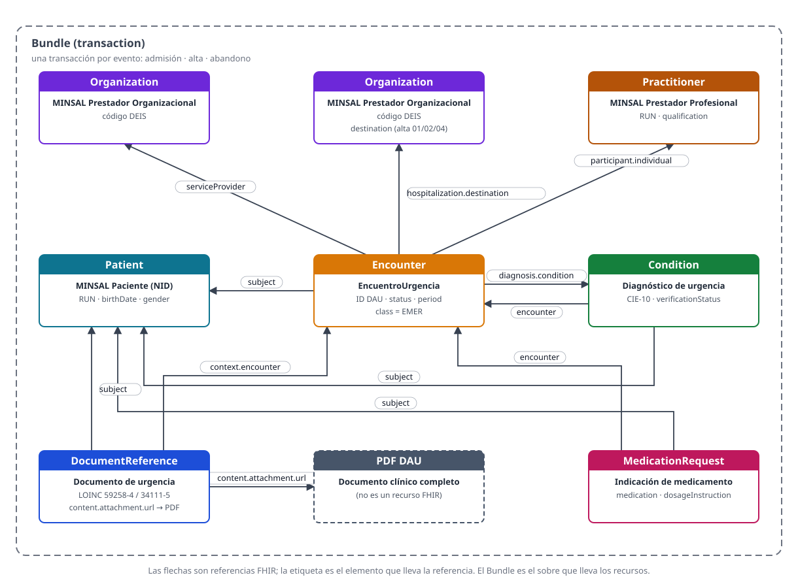

# Propuesta FHIR — Aviso mínimo de atención de urgencia a la red (DAU)

- **Estado:** propuesta para validación (paso 4, `fhir-modeling` + `mapping-to-fhir` + `ihe-profile-review`)
- **Revisión 3 (2026-11-12):** cada operación enlaza al perfil IHE que la apoya (con su página en profiles.ihe.net); se añade la operación de buscar paciente ([PDQm](https://profiles.ihe.net/ITI/PDQm/)) a la consulta (PI-2). Ningún perfil IHE lleva la transacción en sí; los perfiles cubren funciones de apoyo. La sustancia (recursos, campos, mapeo, revisión IHE) no cambia.
- **Revisión 2 (2026-11-12):** los perfiles pasan a ser propios de esta guía (diseñados sobre los recursos base de FHIR R4), con su URL canónica de base y la invitación a elegir otro recurso base. La sustancia (recursos, campos, mapeo, revisión IHE) no cambia; cambia la procedencia de los perfiles.
- **Fecha:** 2026-11-11
- **Spec de origen:** `01-use-case-spec.md` revisión 3 (validada)
- **Modelo de origen:** `02-bpmn-model.md` revisión 4 (validado)
- **Entidades de origen:** `03-entities-data.md` (validado)
- **Tabla de mapeo:** `04-mapping-table.md`
- **Guía de referencia:** Guía de Implementación FHIR — Urgencia (Admisión, Alta y Abandono) v0.2.0 del MINSAL, publicada en https://interoperabilidad.minsal.cl/fhir/ig/cl-urgencia/0.2.0/ (URL oficial: https://interoperabilidad.minsal.cl/fhir/ig/urgencia-eventos/ImplementationGuide/hl7.fhir.cl.minsal.urgencia.eventos). Estado: Draft al 2026-10-08. Verificada en vivo el 2026-11-11 (index, modelo, arquitectura, mapeo CMBD, perfil EncuentroUrgencia, perfil EncuentroUrgenciaAlta, ValueSet vs-destino-alta). Es la referencia de los requisitos de datos que el caso exige informar a la red, no la fuente de los perfiles de esta propuesta.
- **Dependencias de la guía:** FHIR R4 4.0.1 (única dependencia). Referencias de datos: NID 0.4.6, CIE-10 (preferente), SNOMED CT (alternativo), LOINC, MPI MINSAL. CL-Core es la referencia de los requisitos de datos nacionales; solo sería dependencia si se elige un perfil CL-Core como base de algún recurso (ver sección 2).

Esta propuesta diseña **perfiles propios** para el caso de uso, sobre los recursos base de FHIR R4. No adopta ni transcribe los perfiles de otra guía: la guía nacional (MINSAL cl-urgencia v0.2.0) es la referencia de los requisitos de datos, no la fuente de los perfiles. No se inventa un recurso, un perfil ni un código nuevo donde el caso de uso ya tiene uno definido.

## 1. Principio del modelo

- **Un episodio, un `Encounter`.** Cada atención de urgencia es un solo `Encounter` durante toda su vida. Los Bundle de admisión, alta o abandono no crean encuentros nuevos: envían el mismo `Encounter`, identificado por el mismo **ID DAU**, con su estado actualizado.
- **Tres transacciones** (`Bundle` de tipo `transaction`), una por hito: admisión, alta, abandono. El fallecimiento se informa como evento de alta (ver sección 5).
- **Recursos maestros (paciente, establecimiento, profesional): solo crear.** `POST` + `ifNoneExist`. Son compartidos por toda la red y su fuente de verdad es nacional (MPI, registros DEIS y de prestadores). El servidor los crea si no existen y, si ya existen, usa el existente **sin modificarlo**. Así ningún establecimiento sobrescribe los datos que envió otro ni los del MPI.
- **Recursos del episodio: crear o actualizar.** `PUT` condicional por identificador: `Encounter`, `Condition`, `MedicationRequest`, `DocumentReference`. El `PUT` los crea si no existen y los actualiza si ya existen. Si el HIS/RCE reintenta una transacción, no se duplican episodios, diagnósticos ni documentos.
- **El `Encounter` se envía siempre completo.** El `PUT` reemplaza el recurso entero: el alta y el abandono deben repetir todos los datos informados en la admisión (previsión, procedencia, medio de llegada, motivo de consulta, etc.). Un dato omitido se borra del repositorio.
- **Sin `Resource.id` en los recursos con `PUT`.** El id lo determina el servidor al encontrar o crear el recurso por su identificador. Un id en el cuerpo que no coincida con el recurso existente hace fallar la operación.
- **El identificador de la operación es el del recurso.** El `system|value` de `request.url` (o de `ifNoneExist`) debe ser el mismo que trae el recurso.
- **Un solo paciente por Bundle.** El `subject` de encuentro, diagnósticos, indicaciones y documento apunta a la entrada del paciente.
- **Las referencias dentro de la transacción usan `fullUrl` (`urn:uuid:...`).** El servidor las reemplaza por los ids reales al procesarla.
- **Corrección:** para anular un episodio enviado por error se reenvía el `Encounter` con `status = entered-in-error`. El HIS/RCE no debe enviar una admisión de un episodio ya cerrado: el `PUT` lo reabriría (el Bus puede rechazarla).

## 2. Recursos elegidos

Cada recurso se propone con el **recurso base** sobre el que se construye su perfil propio, con su URL canónica. El base por defecto es el recurso base de FHIR R4. **Si quieres que alguno use otro recurso base, dilo aquí**: se registra la elección y la guía la toma como `Parent:` (añadiendo el paquete FHIR de esa guía como dependencia, si es resoluble como paquete). Por ejemplo, para `Patient` puedes querer que el base sea `PatientCL` / `CorePacienteCl` de la guía core de Chile (`https://hl7chile.cl/fhir/ig/clcore/StructureDefinition/CorePacienteCl`, paquete FHIR `hl7.fhir.cl.clcore`).

| Recurso | Perfil propio | Base propuesta (URL canónica) | Uso | Alternativas rechazadas y por qué |
|---|---|---|---|---|
| `Bundle` (transaction) | `DAUBundleAviso` | FHIR R4 `Bundle` — http://hl7.org/fhir/StructureDefinition/Bundle | Las tres transacciones, una por hito | Recursos sueltos sin transacción: se perdería la atomicidad (la transacción se aplica completa o no se aplica) |
| `Patient` | `DAUPaciente` | FHIR R4 `Patient` — http://hl7.org/fhir/StructureDefinition/Patient | Quién fue atendido | `Patient` sin RUN nacional: se pierde el sistema de identificación que la red exige (RUN, ficha local para NN) |
| `Organization` | `DAUPrestadorOrganizacional` | FHIR R4 `Organization` — http://hl7.org/fhir/StructureDefinition/Organization | Establecimiento que atiende (y de destino) | `Organization` sin código DEIS: se pierde el identificador del establecimiento |
| `Practitioner` | `DAUPrestadorProfesional` | FHIR R4 `Practitioner` — http://hl7.org/fhir/StructureDefinition/Practitioner | Profesional que atiende (ATND) y que da el alta (DIS); opcional | Omitirlo: se pierde quién atendió; se envía cuando el HIS lo tiene |
| `Encounter` | `DAUEncuentroUrgencia` (variantes `DAUEncuentroUrgenciaAlta` y `DAUEncuentroUrgenciaAbandono`) | FHIR R4 `Encounter` — http://hl7.org/fhir/StructureDefinition/Encounter | El episodio de urgencia | `Encounter` sin las reglas del caso: se pierden el ID DAU, las extensiones y los invariantes del evento |
| `Condition` | `DAUDiagnosticoUrgencia` | FHIR R4 `Condition` — http://hl7.org/fhir/StructureDefinition/Condition | Hipótesis o diagnóstico de egreso | `Condition` sin CIE-10 en el alta ni la regla provisional/confirmado |
| `MedicationRequest` | `DAUIndicacionMedicamento` | FHIR R4 `MedicationRequest` — http://hl7.org/fhir/StructureDefinition/MedicationRequest | Medicamentos indicados al alta | `MedicationStatement`: significado distinto (es lo que el paciente toma, no lo indicado al alta). `MedicationAdministration`: no se administró en urgencia, se indicó al alta |
| `DocumentReference` | `DAUDocumentoUrgencia` | FHIR R4 `DocumentReference` — http://hl7.org/fhir/StructureDefinition/DocumentReference | Enlace al PDF del DAU | `Binary`: pierde los metadatos (tipo, paciente, encuentro, seguridad). `DiagnosticReport`: es una referencia a un documento, no un informe |

**No se usan:** `Observation` (los signos vitales quedan en el PDF, no estructurados), `DiagnosticReport`, `ServiceRequest` (las solicitudes y resultados de exámenes tienen sus propias guías de laboratorio e imagenología). La `Subscription` la crea el consumidor en el Repositorio para enterarse de los eventos; no es un recurso que el HIS envíe.

### Diagrama de recursos (estilo ClinFHIR GraphBuilder)



Cómo se lee: cada rectángulo es una instancia de recurso, con su tipo y su perfil. Cada flecha es una referencia FHIR, y su etiqueta es el elemento que lleva la referencia. El marco punteado es el `Bundle` (transaction), el sobre que lleva los recursos en cada evento. `Organization` aparece dos veces porque el establecimiento emisor y el establecimiento de destino son dos instancias distintas (pueden coincidir, por ejemplo cuando el paciente se hospitaliza en el mismo establecimiento). El PDF DAU no es un recurso FHIR: es el documento al que apunta `DocumentReference.content.attachment.url`.

El `Encounter` es el centro del grafo: es el único recurso que el episodio actualiza en las tres transacciones. Los recursos maestros (`Patient`, `Organization`, `Practitioner`) solo se crean (`POST` + `ifNoneExist`); los del episodio (`Encounter`, `Condition`, `MedicationRequest`, `DocumentReference`) se crean o actualizan con `PUT` condicional. El diagrama se genera desde `render_fhir_graph.py` (en la raíz de la carpeta de trabajo) y se guarda como `04-fhir-proposal-graph.svg`.

## 3. Campos por recurso

### Encounter — DAUEncuentroUrgencia

| Ruta FHIR | Cardinalidad | Fuente |
|---|---|---|
| `Encounter.identifier` (ID DAU) | 1..* | Admisión (apertura del DAU). `system = https://interoperabilidad.minsal.cl/fhir/sid/dau/[código DEIS]`, `value = ID DAU`. Único en el establecimiento, nunca se reutiliza. Segundo identificador: ID ATENCIÓN, si difiere del ID DAU |
| `Encounter.meta.security` | 0..* | Cierre. `R` (restringido) si la consulta es por abuso sexual, violencia o constatación de lesiones. `system = http://terminology.hl7.org/CodeSystem/v3-Confidentiality` |
| `Encounter.status` | 1..1 | Admisión: `arrived`. Alta/abandono: `finished` (patrón requerido en la variante de alta). Corrección: `entered-in-error` |
| `Encounter.class` | 1..1 | Fijo: `EMER` (`system = http://terminology.hl7.org/CodeSystem/v3-ActCode`) |
| `Encounter.type` | 0..* | Tipo específico de encuentro (CL-Core, ejemplo) |
| `Encounter.serviceType` | 0..1 | Unidad de atención: pediatría, adulto, gineco-obstétrica, odontológica... (ValueSet "Unidad de atención de urgencia", requerido) |
| `Encounter.subject` | 1..1 | Referencia al `Patient` del Bundle |
| `Encounter.participant` (ATND / DIS) | 0..* | ATND: médico tratante, `period.start` = inicio de la atención médica. DIS: profesional que da el alta. `individual` 1..1 → `Practitioner` |
| `Encounter.period.start` | 1..1 | Fecha y hora de admisión |
| `Encounter.period.end` | 0..1 (1..1 en el alta) | Alta: fecha y hora en que el paciente sale físicamente de urgencia. Abandono: fecha y hora en que se constata el abandono. Fallecimiento: hora del fallecimiento (ver sección 5) |
| `Encounter.period.length` | 0..1 | Duración del encuentro |
| `Encounter.reasonCode.text` | 0..1 (text 1..1) | Motivo de consulta, texto libre hasta 200 caracteres |
| `Encounter.diagnosis.condition` | 1..1 (en cada diagnóstico) | Referencia al `Condition` del mismo Bundle |
| `Encounter.diagnosis.use` | 0..1 (1..1 en el alta) | `DD`: diagnóstico de egreso. Obligatorio en el alta; no se usa en el abandono |
| `Encounter.diagnosis.rank` | 0..1 | Orden del diagnóstico (1 = principal) |
| `Encounter.hospitalization.admitSource` | 0..1 | Procedencia del paciente (ValueSet "Procedencia del paciente", requerido) |
| `Encounter.hospitalization.dischargeDisposition` | 0..1 (1..1 en el alta) | Destino de alta o tipo de abandono. En el alta: ValueSet "Destino al alta de urgencia" (requerido). En el abandono: ValueSet "Tipo de abandono" (requerido) |
| `Encounter.hospitalization.destination` | 0..1 | Referencia al `Organization` de destino. Obligatorio con hospitalización (01), traslado (02) o derivación (04) |
| `Encounter.hospitalization.extension[medioLlegada]` | 0..1 | Medio de llegada. URL: https://interoperabilidad.minsal.cl/fhir/ig/urgencia-eventos/StructureDefinition/medio-llegada (ValueSet "Medio de llegada", requerido) |
| `Encounter.serviceProvider` | 1..1 | Referencia al `Organization` que realiza la atención |
| `Encounter.extension[prevision]` | 0..1 | Previsión de salud (con `tramoFonasa`). URL: https://interoperabilidad.minsal.cl/fhir/ig/urgencia-eventos/StructureDefinition/prevision |
| `Encounter.extension[leyPrevisional]` | 0..* | Ley previsional o programa (ValueSet "Leyes Previsionales", extensible). URL: https://interoperabilidad.minsal.cl/fhir/ig/urgencia-eventos/StructureDefinition/ley-previsional |
| `Encounter.extension[clasificacionConsulta]` | 0..1 | Clasificación de la consulta (ValueSet "Clasificación de la consulta", requerido). Con 01, 02 o 03 el episodio se marca como restringido (`meta.security = R`). URL: https://interoperabilidad.minsal.cl/fhir/ig/urgencia-eventos/StructureDefinition/clasificacion-consulta |
| `Encounter.extension[pronosticoMedicoLegal]` | 0..1 | Pronóstico médico-legal (ValueSet "Pronóstico médico-legal", requerido). URL: https://interoperabilidad.minsal.cl/fhir/ig/urgencia-eventos/StructureDefinition/pronostico-medico-legal |
| `Encounter.extension[pertinencia]` | 0..1 | Pertinencia de la atención (boolean). URL: https://interoperabilidad.minsal.cl/fhir/ig/urgencia-eventos/StructureDefinition/pertinencia |

Invariantes del perfil: `urg-enc-1` (un `finished` debe tener `period.end`), `urg-enc-2` (un `finished` debe tener destino o tipo de abandono), `urg-enc-3` (`period.end` no anterior a `period.start`), `urg-enc-4` (solo se informa `use = DD`, y solo en el alta), `urg-enc-5` (las fechas incluyen hora y zona horaria, ISO 8601), `urg-enc-6` (exactamente un ID DAU con el sistema nacional), `urg-enc-7` (episodios restringidos), `urg-enc-8` (con 01/02/04 se informa el establecimiento de destino).

### Patient — DAUPaciente

| Ruta FHIR | Cardinalidad | Fuente |
|---|---|---|
| `Patient.identifier` (RUN) | 1..* | Admisión. `value = RUN-DV`, tipo `01` RUN, `system = urn:oid:2.16.840.1.113883.2.22.1.152.787300`. Alternativos: `05` PPN (pasaporte), `03` RUN Madre, `12` número de ficha clínica local (NN), `14` Otro. El Bus agrega el identificador MPI al resolver la identidad |
| `Patient.birthDate` | — | Admisión. En NN: ausente, con la extensión `data-absent-reason = unknown` |
| `Patient.gender` | — | Admisión. Equivalencia CMBD: `01 → male`, `02 → female`, `03 → other`, `99 → unknown`. En NN: `unknown` |
| `Patient.telecom` | — | Admisión (`system = phone`) |
| `Patient.extension[SexoBiologico]` | — | Admisión (CL-Core `CSSexoListadoDeis`) |
| Campos que exige `MINSALPaciente` aunque el CMBD no los incluye | — | Identidad de género, nacionalidad, país de origen, país emisor del documento, teléfono, fecha de nacimiento, sexo y si está fallecido |
| Reglas NN | — | Identificador tipo `12` con `use = temp`; `gender = unknown`; identidad de género `7` No revelado; `deceased[x] = false`; nacionalidad y país de origen con valor provisorio `152` Chile y `text = "Valor provisorio NN: nacionalidad desconocida"` (los receptores no deben interpretarlo como nacionalidad real). Cuando se conoce la identidad, la vinculación con el MPI queda pendiente de definir con el NID |

### Organization — DAUPrestadorOrganizacional

| Ruta FHIR | Cardinalidad | Fuente |
|---|---|---|
| `Organization.identifier` (código DEIS) | 1..* | Admisión. `system = https://interoperabilidad.minsal.cl/fhir/ig/tei/CodeSystem/CSEstablecimientoDestino` |
| `Organization.partOf` | 0..1 | Servicio de Salud (COD SS del CMBD) |

### Practitioner — DAUPrestadorProfesional

| Ruta FHIR | Cardinalidad | Fuente |
|---|---|---|
| `Practitioner.identifier` (RUN) | 1..* | Atención / alta. `system = urn:oid:2.16.840.1.113883.2.22.1.152.787300` |
| `Practitioner.qualification[TituloProfesional].code` | — | Alta (NID `CSTituloProfesional`) |
| `Practitioner.qualification[EspecialidadMedica].code` | — | Alta (NID `CSEspecialidadMed`) |

### Condition — DAUDiagnosticoUrgencia

| Ruta FHIR | Cardinalidad | Fuente |
|---|---|---|
| `Condition.identifier` | 1..* | Id del diagnóstico en el HIS/RCE (`PUT Condition?identifier=https://hospital.cl/sid/diagnosticos\|DG-...`) |
| `Condition.code.coding` | — | Alta: **CIE-10 obligatorio** (`http://hl7.org/fhir/sid/icd-10`, invariante `urg-alta-cie10`). Hipótesis: opcional (CIE-10, SNOMED CT `http://snomed.info/sct`, o solo texto). TAPSA no se acepta mientras el DEIS no publique su sistema de códigos |
| `Condition.code.text` | — | Alta: texto del diagnóstico final. Hipótesis: puede ir solo en texto si no fue codificada |
| `Condition.verificationStatus` | — | `provisional` (hipótesis) o `confirmed` (confirmado). Los descartados no se informan |
| `Condition.recordedDate` | — | Fecha de registro del diagnóstico |
| `Condition.subject` / `Condition.encounter` | — | Referencias al `Patient` y al `Encounter` del Bundle |
| `Condition.extension[ges]` | — | GES (en el alta) |

### MedicationRequest — DAUIndicacionMedicamento

| Ruta FHIR | Cardinalidad | Fuente |
|---|---|---|
| `MedicationRequest.identifier` | 1..* | Id de la indicación en el HIS/RCE (`PUT MedicationRequest?identifier=https://hospital.cl/sid/indicaciones\|IND-...`) |
| `MedicationRequest.groupIdentifier` | — | ID RECETA |
| `MedicationRequest.medicationCodeableConcept.text` + `dosageInstruction.text` | — | Un `MedicationRequest` por fármaco |
| `MedicationRequest.authoredOn` | — | Fecha de indicación del medicamento |
| `MedicationRequest.subject` / `MedicationRequest.encounter` | — | Referencias al `Patient` y al `Encounter` del Bundle |

### DocumentReference — DAUDocumentoUrgencia

| Ruta FHIR | Cardinalidad | Fuente |
|---|---|---|
| `DocumentReference.identifier` (`masterIdentifier`) | 1..* | `PUT DocumentReference?identifier=https://hospital.cl/sid/documentos\|DOC-...` |
| `DocumentReference.type` | — | Alta: resumen de alta, LOINC `59258-4`. Abandono: nota de urgencia, LOINC `34111-5` (invariantes `urg-alta-documento` y `urg-abandono-documento`). Si el PDF aún no está listo en el alta, se reenvía el Bundle de alta completo cuando exista |
| `DocumentReference.subject` / `DocumentReference.context.encounter` | — | Referencias al `Patient` y al `Encounter` del Bundle |
| `DocumentReference.content.attachment.url` | — | URL del PDF del DAU (con autenticación; no pública). El PDF lo publica el establecimiento emisor (o se replica en el repositorio, según el acuerdo institucional) |
| `DocumentReference.date` | — | Fecha de emisión del documento DAU |
| `DocumentReference.meta.security` | — | `R` en episodios restringidos |

## 4. Contenido por evento

**Obligatorio** = la transacción se rechaza si falta. **Si existe** = se envía cuando el HIS/RCE tiene el dato. (Matriz de la guía, verificada en vivo.)

| Recurso / dato | Admisión | Alta | Abandono | Fallecimiento (sección 5) |
|---|---|---|---|---|
| `Patient` | Obligatorio | Obligatorio | Obligatorio | Obligatorio |
| `Organization` (emisor) | Obligatorio | Obligatorio | Obligatorio | Obligatorio |
| `Encounter.status` | `arrived` | `finished` | `finished` | `finished` |
| `Encounter.period.start` (admisión) | Obligatorio | Obligatorio | Obligatorio | Obligatorio |
| `Encounter.period.end` | No se envía | Obligatorio (salida física) | Obligatorio (constatación del abandono) | Obligatorio (hora del fallecimiento) |
| `Encounter.reasonCode` (motivo de consulta) | Si existe | Si existe | Si existe | Si existe |
| `Encounter.hospitalization.admitSource` (procedencia) | Si existe | Si existe | Si existe | Si existe |
| `Encounter.hospitalization.dischargeDisposition` | No se envía | Obligatorio (destino de alta) | Obligatorio (tipo de abandono) | Obligatorio (`03 Fallecido`) |
| `Encounter.hospitalization.destination` | — | Obligatorio con 01, 02 o 04 | — | No se envía |
| `Condition` (diagnóstico) | — | Obligatorio, al menos uno (`DD`, CIE-10) | Si existe (hipótesis, `provisional`) | Obligatorio, al menos uno (`DD`, CIE-10: causa de muerte) |
| `MedicationRequest` | — | Si existe | — | No se envía |
| `DocumentReference` (PDF) | — | Si existe (resumen de alta, LOINC 59258-4) | Si existe (nota de urgencia, LOINC 34111-5) | Si existe (resumen de alta, LOINC 59258-4) |
| `Practitioner` | Si existe | Si existe (ATND y DIS) | Si existe (ATND si alcanzó a ser atendido) | Si existe (ATND si alcanzó a ser atendido; DIS: profesional que cierra el episodio) |

Cómo se reconoce el evento: no hay un recurso que diga "esto es un alta". El evento se deduce de `Encounter.status` y de `Encounter.hospitalization.dischargeDisposition`. Quien necesite reaccionar a un evento (por ejemplo, avisar al CESFAM de un alta o de una fuga) lo hace suscribiéndose a los cambios de `Encounter` en el repositorio.

## 5. El fallecimiento: decisión del paso 4

### Hallazgo (corrige la nota anterior)

La spec v3 y el BPMN v4 decían que "la guía no contempla el fallecimiento". Eso es impreciso y se corrige aquí: la guía **no nombra un evento separado** de fallecimiento, pero **sí lo contempla como destino de alta**. La evidencia, verificada en vivo el 2026-11-11:

- El ValueSet **"Destino al alta de urgencia"** (`https://interoperabilidad.minsal.cl/fhir/ig/urgencia-eventos/ValueSet/vs-destino-alta`, v0.2.0, Experimental) incluye 6 conceptos en el CodeSystem `https://interoperabilidad.minsal.cl/fhir/ig/urgencia-eventos/CodeSystem/destino-alta`: `01` Hospitalización, `02` Traslado, **`03` Fallecido**, `04` Derivación, `05` Domicilio, `06` Otro.
- El perfil **EncuentroUrgenciaAlta** (https://interoperabilidad.minsal.cl/fhir/ig/urgencia-eventos/StructureDefinition/encuentro-urgencia-alta) liga `Encounter.hospitalization.dischargeDisposition` 1..1 al ValueSet "Destino al alta de urgencia" (requerido). El código `03` es válido en el evento de alta.
- El mapeo CMBD deduce la condición al cierre del destino: **"CONDICIÓN AL CIERRE: `03 Fallecido` → fallecido; otro → vivo"**.

### Decisión

El fallecimiento **se informa como evento de alta** (Bundle de alta, perfil `EncuentroUrgenciaAlta`), con:

- `Encounter.status = finished`, `period.end` = hora del fallecimiento.
- `Encounter.hospitalization.dischargeDisposition = 03 Fallecido` (`system = https://interoperabilidad.minsal.cl/fhir/ig/urgencia-eventos/CodeSystem/destino-alta`).
- `Encounter.diagnosis` con al menos un `Condition` de **causa de muerte**, codificado en **CIE-10**, con `use = DD` (es el diagnóstico de egreso del episodio, como en cualquier alta).
- `DocumentReference` de resumen de alta (LOINC `59258-4`) si existe, como en el alta.
- Sin `MedicationRequest` y sin `hospitalization.destination` (el código `03` no requiere destino).
- Reconocimiento del evento: `status = finished` + `dischargeDisposition = 03` → fallecimiento. Los suscriptores lo distinguen del resto de las altas por el código.

**No se crea un Bundle nuevo ni un perfil nuevo, y no se inventa ningún código.** La rama "Fallecimiento" del BPMN v4 se mantiene como rama clínica (legibilidad del proceso), pero mapea a la transacción de alta con destino `03`.

### Por qué no las alternativas

- **Un Bundle nuevo de fallecimiento con un código nuevo:** rechazado. El código `03 Fallecido` ya existe en el ValueSet del alta y el perfil de alta lo acepta; crear otro Bundle y otro código duplicaría el modelo y rompería la validación contra la guía.
- **Una extensión en el `Encounter` para la muerte:** rechazado. Rompería la regla de reconocimiento de eventos de la guía (el evento se deduce de `status` + `dischargeDisposition`) y los suscriptores no podrían distinguirlo.
- **Registrar la muerte en `Patient.deceased`:** rechazado. Los recursos maestros son solo creación (`POST` + `ifNoneExist`): nunca se modifican. La muerte queda solo en el `Encounter`, como corresponde al episodio.
- **Documento de nota de urgencia (34111-5) en vez de resumen de alta:** rechazado. El invariante `urg-alta-documento` exige el resumen de alta (59258-4) en el evento de alta, y el fallecimiento es un evento de alta.

## 6. Arquitectura y operaciones

### Envío (PI-0, PI-1)

- `POST [base]` con el `Bundle` de tipo `transaction`, `Content-Type: application/fhir+json`. **En el momento del evento** (tiempo real o casi real), no en lotes al final del día.
- Respuesta: `200 OK` → `Bundle` de tipo `transaction-response` con el resultado de cada entrada (`201 Created` o `200 OK`). Error de estructura, perfil o terminología → `400`/`422` con `OperationOutcome` y **no se aplica ninguna entrada**. Identificador condicional ambiguo → `412`. Identidad no resuelta en MPI → `422` y el HIS/RCE corrige y reenvía. Sin respuesta, el HIS/RCE puede **reenviar la misma transacción**: las operaciones condicionales evitan duplicados.
- Procesamiento en el Bus: 1) validar el `Bundle` contra el perfil del evento; 2) validar los códigos contra el Servidor Terminológico; 3) resolver el `Patient` contra el MPI y agregar el identificador MPI; 4) aplicar la transacción en el repositorio (maestros solo si no existen, episodio con `PUT` condicional); 5) registrar la trazabilidad (emisor, fecha de recepción, resultado de validación, respuesta).
- Identidad (MPI): única encontrada → asociar el episodio al paciente MPI. No encontrado → ejecutar la transacción MPI de creación. Duplicada o contradictoria → rechazar y enviar a conciliación. RUN con dígito verificador inválido → rechazar. MPI no disponible → error transitorio y el HIS/RCE reintenta.
- Perfiles IHE: [PIXm](https://profiles.ihe.net/ITI/PIXm/) (parcial — la identidad se resuelve dentro del Bus; ITI-83, ITI-104) y [MHD](https://profiles.ihe.net/ITI/MHD/) (parcial — el cierre incluye un `DocumentReference`; ITI-65, ITI-67, ITI-68). [ATNA](https://profiles.ihe.net/ITI/TF/Volume1/ch-9.html) y [CT](https://profiles.ihe.net/ITI/TF/Volume1/ch-7.html) son transversales. La transacción en sí es nacional; la revisión completa está en la sección 7.

### Consulta y suscripción (PI-2)

- Búsquedas FHIR estándar sobre el Repositorio:
  - Buscar paciente por RUN: `GET [base]/Patient?identifier=urn:oid:2.16.840.1.113883.2.22.1.152.787300|<RUN>` — [PDQm](https://profiles.ihe.net/ITI/PDQm/) (Patient Demographics Query for Mobile, parcial; ITI-78, ITI-119).
  - Atenciones de urgencia de un paciente: `GET [base]/Encounter?patient.identifier=urn:oid:2.16.840.1.113883.2.22.1.152.787300|<RUN>&class=EMER` — [QEDm](https://profiles.ihe.net/PCC/QEDm/) (Mobile Query Existing Data, parcial; PCC-44).
  - Pacientes actualmente en urgencia en un establecimiento: `GET [base]/Encounter?service-provider.identifier=https://interoperabilidad.minsal.cl/fhir/ig/tei/CodeSystem/CSEstablecimientoDestino|<código DEIS>&class=EMER&status=arrived` — [QEDm](https://profiles.ihe.net/PCC/QEDm/) (parcial; PCC-44).
  - Diagnósticos y documento de una atención: `GET [base]/Condition?encounter=Encounter/[id]` — [QEDm](https://profiles.ihe.net/PCC/QEDm/) (parcial; PCC-44); `GET [base]/DocumentReference?encounter=Encounter/[id]` — [MHD](https://profiles.ihe.net/ITI/MHD/) (parcial; ITI-67).
- Para enterarse de un evento apenas ocurre, el consumidor crea una `Subscription` sobre `Encounter` con `class=EMER` ([Subscription FHIR](https://www.hl7.org/fhir/subscription.html); DSUB no encaja, es una suscripción a metadatos de documentos de un registro XDS).

### Recuperación del PDF (PI-3)

- El PDF se descarga desde `DocumentReference.content.attachment.url`, publicado por el establecimiento emisor (o replicado en el repositorio, según el acuerdo institucional). La URL exige autenticación; no es pública.
- Perfil IHE: [MHD](https://profiles.ihe.net/ITI/MHD/) (parcial — recuperar un documento es ITI-68, Retrieve Document; el patrón coincide, el mecanismo no: la guía descarga el PDF con un GET autenticado directo a la URL, no con una transacción ITI-68).

### Seguridad

- Transporte cifrado (TLS 1.2 o superior). Autenticación del sistema emisor ante el Bus (mecanismo definido por MINSAL). HCC muestra al paciente solo sus propias atenciones y **no muestra los episodios restringidos** (`meta.security = R`). El repositorio entrega los recursos restringidos solo a los equipos autorizados. El acceso de la red se rige por las políticas de acceso y el consentimiento del paciente cuando corresponda.

### De urgencia a hospitalización

Si el paciente queda hospitalizado, son **dos atenciones distintas**, cada una con su propio `Encounter`. El de urgencia no se reabre ni se extiende. El de hospitalización es `class = IMP`, con su propio ID, y se recomienda enlazarlo a la urgencia con la extensión estándar de FHIR R4 `encounter-associatedEncounter`, apuntando al episodio de urgencia por su ID DAU. Lo mismo aplica a traslado (`02`) y derivación (`04`): el destino es obligatorio y la atención en el establecimiento de destino es un `Encounter` propio.

## 7. Revisión IHE por punto

Verificación en vivo: repaso temprano en `02-bpmn-model.md` (2026-11-11, profiles.ihe.net: PIXm v3.1.0, PDQm v3.2.0, MHD v4.2.5, mCSD v4.0.0, QEDm v3.0.0 — Publication, FHIR R4; clásicos PIX, PDQ, XDS.b, XDR, DSUB, NAV, ATNA, CT, BPPC en ITI TF Rev 20.2, Final Text). Esta revisión confirma o refuta cada candidato para cada punto. **Ningún perfil IHE lleva la transacción en sí**: las transacciones (Bundle de admisión/alta/abandono) son la interacción nacional de la guía. Los perfiles cubren funciones de apoyo (identidad, documentos, consulta, seguridad, tiempo).

| Punto | Candidatos del repaso | Decisión por perfil | Actores y transacciones (cuando aplica) | Qué queda a medida |
|---|---|---|---|---|
| PI-0 — Publicación del evento de admisión (push HIS → Bus) | PIXm, MHD, NAV, ATNA, CT | **PIXm: parcial.** El Bus resuelve la identidad contra el MPI, que es la función del Patient Identifier Cross-reference Manager (ITI-83 consulta, ITI-104 alimentación). Pero el HIS no llama a PIXm: la resolución ocurre dentro del Bus, como parte de la transacción. **MHD: no encaja.** En la admisión no se publica ningún documento. **NAV: no encaja.** NAV avisa de documentos disponibles; en la admisión no hay documento. **ATNA: parcial (transversal).** Cubre autenticación de nodos y auditoría; la guía exige TLS 1.2+ y autenticación del emisor pero no nombra ATNA ni el formato de auditoría. **CT: parcial (transversal).** Cubre el tiempo consistente; la guía exige ISO 8601 con zona horaria pero no nombra CT ni un servidor de tiempo | PIXm: Patient Identifier Cross-reference Consumer (Bus) ↔ Manager (MPI); ITI-83, ITI-104. ATNA: Secure Node / Audit Record Repository. CT: Time Client / Time Server | La transacción de admisión en sí (Bundle, `PUT Encounter?identifier=…`) |
| PI-1 — Publicación del evento de alta, abandono o fallecimiento (push HIS → Bus) | PIXm, MHD, XDR, ATNA, CT | **PIXm: parcial** (igual que PI-0). **MHD: parcial.** El cierre incluye un `DocumentReference` al DAU; MHD ITI-65 (Provide Document Bundle) cubre publicar el documento con sus metadatos, e ITI-67/ITI-68 buscarlo y recuperarlo. Pero la guía lleva el documento como referencia dentro del Bundle de cierre, y el PDF se descarga por su URL; no se usa una transacción MHD. **XDR: no encaja.** El push de la guía es una transacción Bundle FHIR al Bus, no un envío punto a punto de documentos XDR, que no llevaría las actualizaciones del `Encounter`. **ATNA: parcial (transversal).** **CT: parcial (transversal)** | MHD: Document Source (HIS/RCE) ↔ Document Recipient (Repositorio); ITI-65, ITI-67, ITI-68. PIXm: como en PI-0 | La transacción de cierre en sí (Bundle, `PUT` condicional del episodio completo) |
| PI-2 — Consulta de episodios (pull receptor → Repositorio, o suscripción) | QEDm, DSUB, MHD, ATNA, CT | **QEDm: parcial.** El patrón de consultar datos existentes por búsqueda FHIR (PCC-44, Mobile Query Existing Data) coincide con las búsquedas de la guía (`Encounter?patient.identifier=…&class=EMER`, `Condition?encounter=`, `DocumentReference?encounter=`). Pero la guía no declara conformidad QEDm ni sus opciones; la consulta central (episodios por paciente) es una búsqueda FHIR simple, no una transacción QEDm. **DSUB: no encaja.** La suscripción de la guía es una `Subscription` FHIR sobre `Encounter class=EMER`; DSUB es una suscripción a metadatos de documentos de un registro XDS, y el Repositorio aquí es un repositorio FHIR, no un registro XDS. **MHD: parcial.** Buscar listas (ITI-66) y referencias (ITI-67) de documentos coincide con localizar el DAU, pero la guía lo hace con una búsqueda FHIR simple (`DocumentReference?encounter=`), no con transacciones MHD. **ATNA: parcial (transversal).** **CT: parcial (transversal)** | QEDm: Clinical Data Consumer (receptor) ↔ Clinical Data Source (Repositorio); PCC-44. MHD: Document Consumer ↔ Document Responder; ITI-66, ITI-67 | Las búsquedas FHIR de la guía y la `Subscription` sobre `Encounter` |
| PI-3 — Recuperación del DAU en PDF (receptor → HIS) | MHD, ATNA, CT | **MHD: parcial.** ITI-68 (Retrieve Document) es la forma estándar de recuperar un documento. Pero la guía descarga el PDF con un GET autenticado directo a `DocumentReference.content.attachment.url`, no con una transacción ITI-68 contra un Document Responder. El patrón coincide; el mecanismo no. **ATNA: parcial (transversal).** **CT: parcial (transversal)** | MHD: Document Consumer (receptor) ↔ Document Responder (HIS/RCE); ITI-68 | La descarga autenticada por URL del PDF |

### Brechas y riesgos

| Brecha / riesgo | Severidad | Detalle |
|---|---|---|
| La conciliación de identidades duplicadas o contradictorias no está definida | Media | El Bus rechaza y envía a conciliación, pero el proceso de conciliación no está descrito en la guía |
| La vinculación del MPI para pacientes NN una vez conocida la identidad está pendiente de definir con el NID | Media | La guía lo dice explícito ("queda pendiente de definir con el NID") |
| El documento DAU vive en el HIS; si el HIS no está disponible, el PDF no se puede descargar | Media | El Repositorio guarda la referencia, no necesariamente el documento; la replicación es por acuerdo institucional, no está garantizada |
| El consentimiento se aplica por políticas de acceso y etiquetas de seguridad, no por un perfil IHE (BPPC refutado) | Baja–media | La guía marca los episodios restringidos con `meta.security = R` y HCC no los muestra; no hay documentos de consentimiento BPPC en el flujo |
| La auditoría no está estandarizada a ATNA | Baja | El Bus registra trazabilidad (emisor, fecha de recepción, resultado de validación, respuesta), pero el formato de auditoría no es ATNA |
| El canal de notificación de la `Subscription` no está especificado | Baja | La guía dice que el consumidor crea una `Subscription` sobre `Encounter class=EMER`; el canal (por ejemplo, REST-hook) es un detalle de implementación |
| La admisión del C1 en la vía rápida puede completarse durante la atención; la guía prohíbe enviar una admisión de un episodio ya cerrado | Baja | El Bundle de cierre crea el episodio si no existe ("un alta sin admisión previa crea el episodio igual"), así que el caso está cubierto por la guía |

## 8. Ejemplos mínimos (sintéticos)

Datos sintéticos de los ejemplos de la propia guía (DAU-2026-000123, establecimiento DEIS 112100, RUN 11111111-1). Son ilustrativos; se validan contra los perfiles en el paso 5 (SUSHI + validador).

**Encounter de admisión (mínimo):**

```json
{
  "resourceType": "Encounter",
  "meta": { "profile": ["https://interoperabilidad.minsal.cl/fhir/ig/urgencia-eventos/StructureDefinition/encuentro-urgencia-admision"] },
  "identifier": [{ "system": "https://interoperabilidad.minsal.cl/fhir/sid/dau/112100", "value": "DAU-2026-000123" }],
  "status": "arrived",
  "class": { "system": "http://terminology.hl7.org/CodeSystem/v3-ActCode", "code": "EMER" },
  "subject": { "reference": "urn:uuid:paciente-1" },
  "serviceProvider": { "reference": "urn:uuid:establecimiento-1" },
  "period": { "start": "2026-09-09T10:00:00-03:00" },
  "reasonCode": [{ "text": "Dolor torácico" }]
}
```

**Encounter de alta con fallecimiento (mínimo, destino 03):**

```json
{
  "resourceType": "Encounter",
  "meta": { "profile": ["https://interoperabilidad.minsal.cl/fhir/ig/urgencia-eventos/StructureDefinition/encuentro-urgencia-alta"] },
  "identifier": [{ "system": "https://interoperabilidad.minsal.cl/fhir/sid/dau/112100", "value": "DAU-2026-000123" }],
  "status": "finished",
  "class": { "system": "http://terminology.hl7.org/CodeSystem/v3-ActCode", "code": "EMER" },
  "subject": { "reference": "urn:uuid:paciente-1" },
  "serviceProvider": { "reference": "urn:uuid:establecimiento-1" },
  "period": { "start": "2026-09-09T10:00:00-03:00", "end": "2026-09-09T12:30:00-03:00" },
  "reasonCode": [{ "text": "Dolor torácico" }],
  "diagnosis": [{ "condition": { "reference": "urn:uuid:diagnostico-1" }, "use": { "coding": [{ "system": "http://terminology.hl7.org/CodeSystem/diagnosis-role", "code": "DD" }] }, "rank": 1 }],
  "hospitalization": { "dischargeDisposition": { "coding": [{ "system": "https://interoperabilidad.minsal.cl/fhir/ig/urgencia-eventos/CodeSystem/destino-alta", "code": "03", "display": "Fallecido" }] } }
}
```

**Condition de causa de muerte (mínimo, sintético):**

```json
{
  "resourceType": "Condition",
  "identifier": [{ "system": "https://hospital.cl/sid/diagnosticos", "value": "DG-88001" }],
  "code": { "coding": [{ "system": "http://hl7.org/fhir/sid/icd-10", "code": "I46.9", "display": "Paro cardíaco, no especificado" }], "text": "Paro cardiorrespiratorio" },
  "subject": { "reference": "urn:uuid:paciente-1" },
  "encounter": { "reference": "urn:uuid:encuentro-1" },
  "verificationStatus": { "coding": [{ "system": "http://terminology.hl7.org/CodeSystem/condition-ver-status", "code": "confirmed" }] },
  "recordedDate": "2026-09-09T12:25:00-03:00"
}
```

**DocumentReference del DAU (mínimo):**

```json
{
  "resourceType": "DocumentReference",
  "identifier": [{ "system": "https://hospital.cl/sid/documentos", "value": "DOC-000123" }],
  "status": "current",
  "type": { "coding": [{ "system": "http://loinc.org", "code": "59258-4", "display": "Emergency department Discharge summary" }] },
  "subject": { "reference": "urn:uuid:paciente-1" },
  "context": { "encounter": [{ "reference": "urn:uuid:encuentro-1" }] },
  "content": [{ "attachment": { "contentType": "application/pdf", "url": "https://hospital.cl/fhir/DocumentReference/DOC-000123/$download" } }],
  "date": "2026-09-09T12:35:00-03:00"
}
```

## Validación

Pendiente: la propuesta y la tabla de mapeo se presentan al usuario para validación. Sin validación no se avanza a la Guía de Implementación con SUSHI (paso 5). Puerta dura: nada a la guía sin propuesta FHIR validada.
