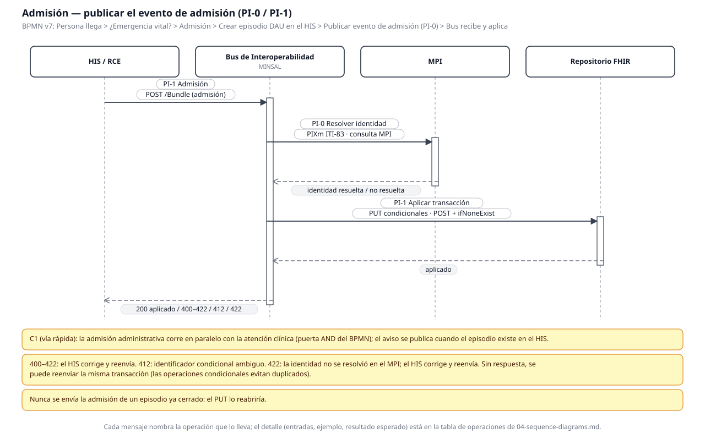
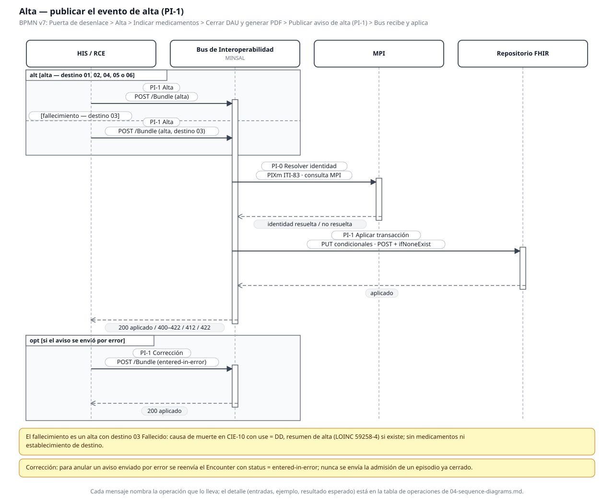
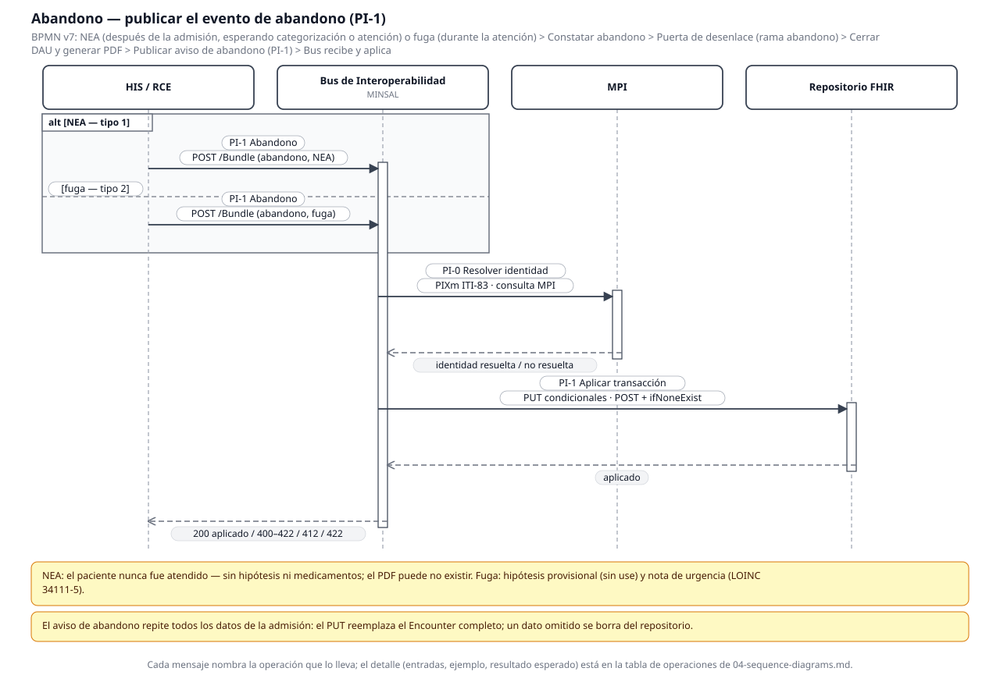
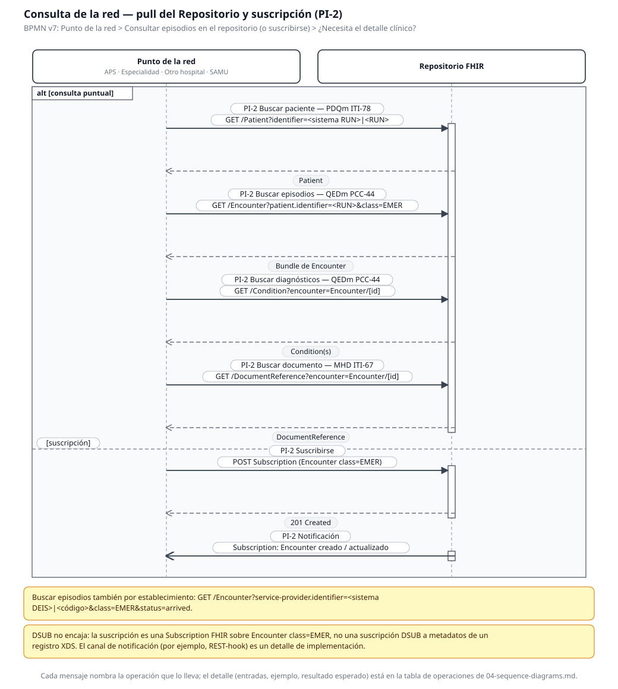
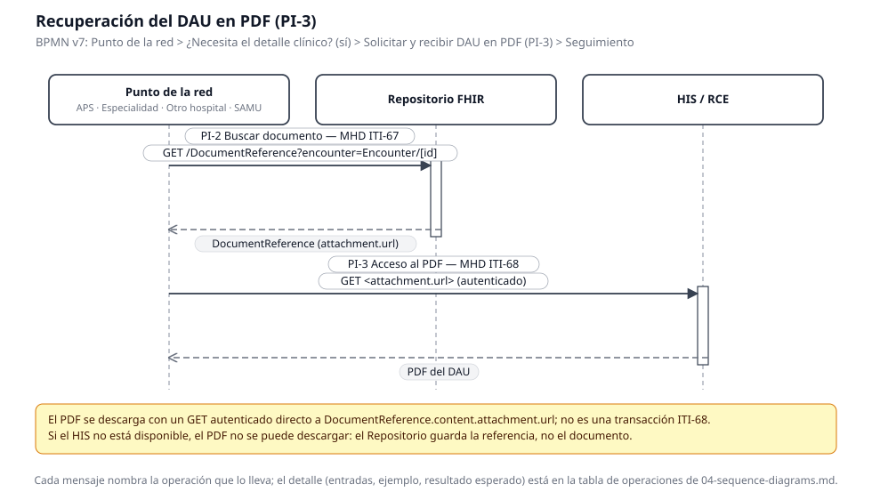

# Diagramas de secuencia — Aviso mínimo de atención de urgencia a la red (DAU)

- **Estado:** diagramas generados con la skill `sequence-diagrams` (pack v0.17.0), pendientes de validación por el usuario
- **Fecha:** 2026-11-12
- **Spec de origen:** `01-use-case-spec.md` revisión 3 (validada)
- **Modelo de origen:** `02-bpmn-model.md` v7 (validado)
- **Propuesta de origen:** `04-fhir-proposal.md` revisión 3 (validada)
- **Operaciones de origen:** `05-implementation-guide/input/pagecontent/operations.md` (cada operación con su perfil IHE)
- **Generador:** `render_sequence.py` (en la raíz de la carpeta de trabajo, junto a `render_bpmn.py` y `render_fhir_graph.py`). El SVG es la fuente; el PNG (2×) va a `05-implementation-guide/input/images/` para la guía. Regenerar con `python3 render_sequence.py`; verificar la regla de referencia con `python3 render_sequence.py --check`.

Las operaciones son una lista; un diagrama de secuencia las muestra en el tiempo: quién llama a quién, en qué orden, qué vuelve y qué puede fallar. Cada diagrama cubre **un flujo** (un camino del BPMN v7 desde un evento de inicio hasta un evento de fin), y **cada mensaje nombra la operación que lo lleva** (id PI-n, interacción FHIR, perfil IHE cuando uno aplica). Flecha sólida = síncrono (el emisor espera la respuesta); flecha abierta = asíncrono (push sin espera); flecha punteada = retorno, con el resultado que la operación promete.

## Inventario de operaciones (11)

Las 11 operaciones de la propuesta y de la guía. Cada una aparece en al menos un diagrama; ningún mensaje nombra una operación fuera de este inventario.

| # | Operación | Interacción FHIR | Perfil IHE |
|---|---|---|---|
| 1 | PI-0 Resolver identidad | Consulta al MPI (dentro del Bus) | PIXm ITI-83 |
| 2 | PI-1 Admisión | `POST /Bundle` (admisión) | Ninguno (transacción nacional); PIXm parcial (identidad) |
| 3 | PI-1 Alta | `POST /Bundle` (alta) | Ninguno (transacción nacional); PIXm + MHD parciales |
| 4 | PI-1 Abandono | `POST /Bundle` (abandono) | Ninguno (transacción nacional); PIXm + MHD parciales |
| 5 | PI-1 Corrección | `POST /Bundle` (Encounter `entered-in-error`) | Ninguno (transacción nacional) |
| 6 | PI-2 Buscar paciente | `GET /Patient?identifier=<sistema RUN>|<RUN>` | PDQm ITI-78 |
| 7 | PI-2 Buscar episodios | `GET /Encounter?patient.identifier=<RUN>&class=EMER` | QEDm PCC-44 |
| 8 | PI-2 Buscar diagnósticos | `GET /Condition?encounter=Encounter/[id]` | QEDm PCC-44 |
| 9 | PI-2 Buscar documento | `GET /DocumentReference?encounter=Encounter/[id]` | MHD ITI-67 |
| 10 | PI-2 Suscribirse | `POST Subscription` (Encounter `class=EMER`) | Ninguno — Subscription FHIR (DSUB refutado) |
| 11 | PI-3 Acceso al PDF | `GET <DocumentReference.content.attachment.url>` (autenticado) | MHD ITI-68 |

## 1. Admisión — `04-sequence-admission.svg`

**Flujo (BPMN v7):** Persona llega → ¿Emergencia vital? → Admisión → Crear episodio DAU en el HIS → Publicar evento de admisión (PI-0) → Bus recibe y aplica.

**Participantes (en orden de primera actuación):** HIS / RCE, Bus de Interoperabilidad MINSAL, MPI, Repositorio FHIR.

| Mensaje | Operación (guía, sección) | Perfil IHE | Resultado esperado |
|---|---|---|---|
| 1. HIS/RCE → Bus: `POST /Bundle` (admisión) | PI-1 Admisión (operations.md, Admisión) | Ninguno (transacción nacional) | 200 transaction-response |
| 2. Bus → MPI: resolver identidad | PI-0 Resolver identidad (operations.md, PI-0) | PIXm ITI-83 | Identidad resuelta (asociada al MPI) |
| 3. MPI → Bus (retorno) | PI-0 Resolver identidad | PIXm ITI-83 | identidad resuelta / no resuelta |
| 4. Bus → Repositorio: aplicar transacción | PI-1 Admisión — aplicación en el Repositorio (operations.md, Admisión) | Ninguno (transacción nacional) | aplicado |
| 5. Repositorio → Bus (retorno) | PI-1 Admisión | — | aplicado |
| 6. Bus → HIS/RCE (retorno) | PI-1 Admisión | — | 200 aplicado / 400–422 corregir y reenviar / 412 ambiguo / 422 identidad no resuelta |

Notas del diagrama: C1 (vía rápida) — la admisión administrativa corre en paralelo con la atención clínica (puerta AND del BPMN); el aviso se publica cuando el episodio existe en el HIS. Nunca se envía la admisión de un episodio ya cerrado: el PUT lo reabriría.

## 2. Alta — `04-sequence-discharge.svg`

**Flujo (BPMN v7):** Puerta de desenlace → Alta → Indicar medicamentos → Cerrar DAU y generar PDF → Publicar aviso de alta (PI-1) → Bus recibe y aplica.

**Participantes:** HIS / RCE, Bus de Interoperabilidad MINSAL, MPI, Repositorio FHIR.

| Mensaje | Operación (guía, sección) | Perfil IHE | Resultado esperado |
|---|---|---|---|
| 1a. HIS/RCE → Bus: `POST /Bundle` (alta) — alt [alta, destino 01, 02, 04, 05 o 06] | PI-1 Alta (operations.md, Alta) | Ninguno (transacción nacional) | 200 transaction-response |
| 1b. HIS/RCE → Bus: `POST /Bundle` (alta, destino 03) — alt [fallecimiento, destino 03] | PI-1 Alta (operations.md, Alta) | Ninguno (transacción nacional) | 200 transaction-response |
| 2. Bus → MPI: resolver identidad | PI-0 Resolver identidad (operations.md, PI-0) | PIXm ITI-83 | Identidad resuelta |
| 3. MPI → Bus (retorno) | PI-0 Resolver identidad | PIXm ITI-83 | identidad resuelta / no resuelta |
| 4. Bus → Repositorio: aplicar transacción | PI-1 Alta — aplicación en el Repositorio (operations.md, Alta) | Ninguno (transacción nacional) | aplicado |
| 5. Repositorio → Bus (retorno) | PI-1 Alta | — | aplicado |
| 6. Bus → HIS/RCE (retorno) | PI-1 Alta | — | 200 aplicado / 400–422 / 412 / 422 |
| 7. HIS/RCE → Bus: `POST /Bundle` (entered-in-error) — opt [si el aviso se envió por error] | PI-1 Corrección (operations.md, Corrección) | Ninguno (transacción nacional) | 200 aplicado |
| 8. Bus → HIS/RCE (retorno) | PI-1 Corrección | — | 200 aplicado |

Notas del diagrama: el fallecimiento es un alta con destino `03 Fallecido` (causa de muerte en CIE-10 con `use = DD`, resumen de alta LOINC 59258-4 si existe; sin medicamentos ni establecimiento de destino). La corrección reenvía el `Encounter` con `status = entered-in-error`; nunca se envía la admisión de un episodio ya cerrado.

## 3. Abandono — `04-sequence-abandonment.svg`

**Flujo (BPMN v7):** NEA (después de la admisión, esperando categorización o atención) o fuga (durante la atención) → Constatar abandono → Puerta de desenlace (rama abandono) → Cerrar DAU y generar PDF → Publicar aviso de abandono (PI-1) → Bus recibe y aplica.

**Participantes:** HIS / RCE, Bus de Interoperabilidad MINSAL, MPI, Repositorio FHIR.

| Mensaje | Operación (guía, sección) | Perfil IHE | Resultado esperado |
|---|---|---|---|
| 1a. HIS/RCE → Bus: `POST /Bundle` (abandono, NEA) — alt [NEA, tipo 1] | PI-1 Abandono (operations.md, Abandono) | Ninguno (transacción nacional) | 200 transaction-response |
| 1b. HIS/RCE → Bus: `POST /Bundle` (abandono, fuga) — alt [fuga, tipo 2] | PI-1 Abandono (operations.md, Abandono) | Ninguno (transacción nacional) | 200 transaction-response |
| 2. Bus → MPI: resolver identidad | PI-0 Resolver identidad (operations.md, PI-0) | PIXm ITI-83 | Identidad resuelta |
| 3. MPI → Bus (retorno) | PI-0 Resolver identidad | PIXm ITI-83 | identidad resuelta / no resuelta |
| 4. Bus → Repositorio: aplicar transacción | PI-1 Abandono — aplicación en el Repositorio (operations.md, Abandono) | Ninguno (transacción nacional) | aplicado |
| 5. Repositorio → Bus (retorno) | PI-1 Abandono | — | aplicado |
| 6. Bus → HIS/RCE (retorno) | PI-1 Abandono | — | 200 aplicado / 400–422 / 412 / 422 |

Notas del diagrama: NEA — el paciente nunca fue atendido (sin hipótesis ni medicamentos; el PDF puede no existir). Fuga — hipótesis provisional (sin `use`) y nota de urgencia (LOINC 34111-5). El aviso de abandono repite todos los datos de la admisión: el PUT reemplaza el `Encounter` completo; un dato omitido se borra del repositorio.

## 4. Consulta de la red — `04-sequence-network-pull.svg`

**Flujo (BPMN v7):** Punto de la red → Consultar episodios en el repositorio (o suscribirse) → ¿Necesita el detalle clínico?

**Participantes:** Punto de la red (APS, especialidad, otro hospital, SAMU), Repositorio FHIR.

| Mensaje | Operación (guía, sección) | Perfil IHE | Resultado esperado |
|---|---|---|---|
| 1. Punto de la red → Repositorio: `GET /Patient?identifier=<RUN>` — alt [consulta puntual] | PI-2 Buscar paciente (operations.md, Buscar paciente) | PDQm ITI-78 | Patient |
| 2. Repositorio → Punto de la red (retorno) | PI-2 Buscar paciente | PDQm ITI-78 | Patient |
| 3. Punto de la red → Repositorio: `GET /Encounter?patient.identifier=<RUN>&class=EMER` | PI-2 Buscar episodios (operations.md, Buscar episodios) | QEDm PCC-44 | Bundle de Encounter |
| 4. Repositorio → Punto de la red (retorno) | PI-2 Buscar episodios | QEDm PCC-44 | Bundle de Encounter |
| 5. Punto de la red → Repositorio: `GET /Condition?encounter=Encounter/[id]` | PI-2 Buscar diagnósticos (operations.md, Buscar diagnósticos del episodio) | QEDm PCC-44 | Condition(s) |
| 6. Repositorio → Punto de la red (retorno) | PI-2 Buscar diagnósticos | QEDm PCC-44 | Condition(s) |
| 7. Punto de la red → Repositorio: `GET /DocumentReference?encounter=Encounter/[id]` | PI-2 Buscar documento (operations.md, Buscar documento del episodio) | MHD ITI-67 | DocumentReference |
| 8. Repositorio → Punto de la red (retorno) | PI-2 Buscar documento | MHD ITI-67 | DocumentReference |
| 9. Punto de la red → Repositorio: `POST Subscription` (Encounter `class=EMER`) — alt [suscripción] | PI-2 Suscribirse (operations.md, Suscribirse a episodios) | Ninguno — Subscription FHIR (DSUB refutado) | 201 Created |
| 10. Repositorio → Punto de la red (retorno) | PI-2 Suscribirse | — | 201 Created |
| 11. Repositorio → Punto de la red: notificación (asíncrono) | PI-2 Suscribirse (operations.md, Suscribirse a episodios) | Ninguno — Subscription FHIR | Encounter creado / actualizado |

Notas del diagrama: buscar episodios también por establecimiento (`GET /Encounter?service-provider.identifier=<sistema DEIS>|<código>&class=EMER&status=arrived`). DSUB no encaja: la suscripción es una `Subscription` FHIR sobre `Encounter class=EMER`, no una suscripción DSUB a metadatos de un registro XDS; el canal de notificación (por ejemplo, REST-hook) es un detalle de implementación.

## 5. Recuperación del DAU en PDF — `04-sequence-document-retrieval.svg`

**Flujo (BPMN v7):** Punto de la red → ¿Necesita el detalle clínico? (sí) → Solicitar y recibir DAU en PDF (PI-3) → Seguimiento.

**Participantes:** Punto de la red (APS, especialidad, otro hospital, SAMU), Repositorio FHIR, HIS / RCE.

| Mensaje | Operación (guía, sección) | Perfil IHE | Resultado esperado |
|---|---|---|---|
| 1. Punto de la red → Repositorio: `GET /DocumentReference?encounter=Encounter/[id]` | PI-2 Buscar documento (operations.md, Buscar documento del episodio) | MHD ITI-67 | DocumentReference (con `attachment.url`) |
| 2. Repositorio → Punto de la red (retorno) | PI-2 Buscar documento | MHD ITI-67 | DocumentReference (con `attachment.url`) |
| 3. Punto de la red → HIS/RCE: `GET <attachment.url>` (autenticado) | PI-3 Acceso al PDF (operations.md, PI-3) | MHD ITI-68 | PDF del DAU |
| 4. HIS/RCE → Punto de la red (retorno) | PI-3 Acceso al PDF | MHD ITI-68 | PDF del DAU |

Notas del diagrama: el PDF se descarga con un GET autenticado directo a `DocumentReference.content.attachment.url`; no es una transacción ITI-68. Si el HIS no está disponible, el PDF no se puede descargar: el Repositorio guarda la referencia, no el documento.

## Verificación

- **Mecánica** (`python3 render_sequence.py --check`, 2026-11-12): 5 diagramas, 11 operaciones en el inventario, 20 mensajes de envío y 17 retornos; **0 mensajes sin una operación conocida, 0 operaciones sin diagrama**. La regla dura de la skill se cumple.
- **Visual** (2026-11-12): los 5 PNG mirados a tamaño de visualización, por zonas. Hallazgos del primer render y su corrección en el generador (no en el diagrama): (1) la fuente por defecto de cairosvg no tiene U+2192 (→) y los subtítulos salían con cajas vacías — se escribe `>` en los subtítulos; (2) la pestaña del fragmento `alt`/`opt` solapaba 50×9 px y 44×9 px la etiqueta del primer mensaje en el diagrama de alta — la pestaña ahora va 70 px sobre la primera flecha; (3) la guarda del segundo operando (`[fallecimiento — destino 03]`, `[fuga — tipo 2]`) se salía por el borde izquierdo del fragmento — ahora va anclada a la izquierda dentro del fragmento; (4) las dos líneas de una etiqueta solapaban sus píldoras 2 px — el interlineado pasa de 16 a 19 px. Tras las correcciones: **0 solapamientos y 0 caracteres tofu en los 5 SVG** (verificado por programa sobre los rectángulos del SVG) y el diagrama de alta vuelto a mirar completo.
- **Guía:** los 5 PNG están en `05-implementation-guide/input/images/` y la página `sequences.md` los muestra a su ancho nativo con zoom; SUSHI compila con 0 errores y 0 warnings (ver `validation.md`).

## Validación

Pendiente: los diagramas se presentan al usuario para validación. Sin validación no se dan por cerrados.
